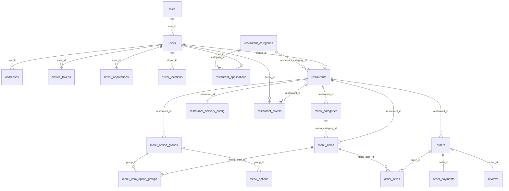

# 🗄️ Estructura de Base de Datos — Al Toque Delivery

**Proyecto:** al-toque-delivery | **Región:** us-west-2 | **PostgreSQL:** 17.11 | **Estado:** ACTIVE_HEALTHY

---

## 📊 Resumen de Tablas (22 tablas)

| Tabla | Filas | RLS |
|-------|------:|:---:|
| `users` | 3 | ✅ |
| `roles` | 4 | ❌ |
| `addresses` | 2 | ✅ |
| `orders` | 0 | ✅ |
| `restaurants` | 1 | ❌ |
| `restaurant_categories` | 1 | ❌ |
| `restaurant_delivery_config` | 1 | ❌ |
| `restaurant_applications` | 0 | ❌ |
| `restaurant_drivers` | 0 | ❌ |
| `menu_categories` | 4 | ❌ |
| `menu_items` | 1 | ❌ |
| `menu_option_groups` | 0 | ❌ |
| `menu_options` | 0 | ❌ |
| `menu_item_option_groups` | 0 | ❌ |
| `order_items` | 0 | ❌ |
| `order_payments` | 0 | ❌ |
| `reviews` | 0 | ❌ |
| `categories` | 0 | ❌ |
| `payment_methods` | 0 | ❌ |
| `device_tokens` | 0 | ❌ |
| `driver_applications` | 0 | ❌ |
| `driver_locations` | 0 | ❌ |

---

## 🔗 Diagrama de Relaciones (ER)

---

## 📋 Detalle por Tabla

### 🧑 `users`
| Columna | Tipo | Nullable | Default |
|---------|------|:--------:|---------|
| `id` | text | NO | — |
| `email` | varchar(100) | YES | — |
| `name` | varchar(50) | YES | — |
| `phone` | varchar(20) | YES | — |
| `phone_verified` | boolean | NO | `false` |
| `is_active` | boolean | NO | `true` |
| `role_id` | integer | YES | — |
| `created_at` | timestamptz | NO | `now()` |
| `updated_at` | timestamptz | NO | `now()` |

> **Constraints:** PK(`id`), UNIQUE(`email`), UNIQUE(`phone`), FK(`role_id` → `roles.id`)

---

### 🔐 `roles`
| Columna | Tipo | Nullable | Default |
|---------|------|:--------:|---------|
| `id` | integer | NO | auto-increment |
| `name` | enum (roles_name_enum) | NO | `'client'` |

> **Constraints:** PK(`id`)

---

### 📍 `addresses`
| Columna | Tipo | Nullable | Default |
|---------|------|:--------:|---------|
| `id` | uuid | NO | `uuid_generate_v4()` |
| `user_id` | text | YES | — |
| `street` | varchar | NO | — |
| `city` | varchar(100) | NO | — |
| `postal_code` | varchar(20) | NO | — |
| `reference` | text | YES | — |
| `type` | enum (addresses_type_enum) | NO | `'home'` |
| `is_default` | boolean | NO | `false` |
| `location` | geometry/geography | YES | — |
| `created_at` | timestamptz | NO | `now()` |
| `updated_at` | timestamptz | NO | `now()` |

> **Constraints:** PK(`id`), FK(`user_id` → `users.id`)

---

### 🍽️ `restaurants`
| Columna | Tipo | Nullable | Default |
|---------|------|:--------:|---------|
| `id` | uuid | NO | `uuid_generate_v4()` |
| `owner_id` | text | NO | — |
| `restaurant_category_id` | uuid | YES | — |
| `name` | varchar(255) | NO | — |
| `address` | varchar(255) | NO | — |
| `phone` | varchar(20) | NO | — |
| `city` | enum | YES | — |
| `image_url` | varchar | YES | — |
| `average_prep_time` | integer | NO | `15` |
| `is_active` | boolean | NO | `true` |
| `location` | geometry/geography | YES | — |
| `created_at` | timestamptz | NO | `now()` |
| `updated_at` | timestamptz | NO | `now()` |

> **Constraints:** PK(`id`), FK(`owner_id` → `users.id`), FK(`restaurant_category_id` → `restaurant_categories.id`)

---

### 🏷️ `restaurant_categories`
| Columna | Tipo | Nullable | Default |
|---------|------|:--------:|---------|
| `id` | uuid | NO | `uuid_generate_v4()` |
| `name` | varchar(100) | NO | — |
| `description` | text | YES | — |
| `icon` | varchar(255) | YES | — |
| `isActive` | boolean | NO | `true` |
| `created_at` | timestamptz | NO | `now()` |
| `updated_at` | timestamptz | NO | `now()` |

> **Constraints:** PK(`id`), UNIQUE(`name`)

---

### 🚚 `restaurant_delivery_config`
| Columna | Tipo | Nullable | Default |
|---------|------|:--------:|---------|
| `id` | uuid | NO | `uuid_generate_v4()` |
| `restaurant_id` | uuid | NO | — |
| `delivery_fee` | numeric | NO | `0` |
| `free_delivery_threshold` | numeric | YES | — |
| `min_order_amount` | numeric | YES | — |
| `max_delivery_distance` | integer | NO | `10` |
| `estimated_delivery_time` | integer | NO | `30` |
| `is_delivery_enabled` | boolean | NO | `true` |
| `delivery_type` | enum | NO | `'platform'` |
| `created_at` | timestamp | NO | `now()` |
| `updated_at` | timestamp | NO | `now()` |

> **Constraints:** PK(`id`), UNIQUE(`restaurant_id`), FK(`restaurant_id` → `restaurants.id`)

---

### 📝 `restaurant_applications`
| Columna | Tipo | Nullable | Default |
|---------|------|:--------:|---------|
| `id` | uuid | NO | `uuid_generate_v4()` |
| `user_id` | text | NO | — |
| `business_name` | varchar(255) | NO | — |
| `business_phone` | varchar(20) | NO | — |
| `business_email` | varchar(100) | YES | — |
| `address` | text | NO | — |
| `category_id` | uuid | NO | — |
| `city` | enum | NO | — |
| `owner_name` | varchar(255) | NO | — |
| `owner_dni` | varchar(20) | NO | — |
| `additional_comments` | text | YES | — |
| `status` | enum | NO | `'pending'` |
| `admin_notes` | text | YES | — |
| `reviewed_by` | text | YES | — |
| `reviewed_at` | timestamptz | YES | — |
| `restaurant_id` | uuid | YES | — |
| `created_at` | timestamptz | NO | `now()` |
| `updated_at` | timestamptz | NO | `now()` |

> **Constraints:** PK(`id`), FK(`user_id` → `users.id`), FK(`category_id` → `restaurant_categories.id`), FK(`reviewed_by` → `users.id`)

---

### 🏍️ `restaurant_drivers`
| Columna | Tipo | Nullable | Default |
|---------|------|:--------:|---------|
| `id` | uuid | NO | `uuid_generate_v4()` |
| `restaurant_id` | uuid | NO | — |
| `driver_id` | text | NO | — |
| `is_active` | boolean | NO | `true` |
| `created_at` | timestamp | NO | `now()` |
| `updated_at` | timestamp | NO | `now()` |

> **Constraints:** PK(`id`), UNIQUE(`restaurant_id`, `driver_id`), FK(`restaurant_id` → `restaurants.id`), FK(`driver_id` → `users.id`)

---

### 📂 `menu_categories`
| Columna | Tipo | Nullable | Default |
|---------|------|:--------:|---------|
| `id` | uuid | NO | `uuid_generate_v4()` |
| `restaurant_id` | uuid | NO | — |
| `name` | varchar(100) | NO | — |
| `description` | text | YES | — |
| `sortOrder` | integer | NO | `0` |
| `isActive` | boolean | NO | `true` |
| `created_at` | timestamptz | NO | `now()` |
| `updated_at` | timestamptz | NO | `now()` |

> **Constraints:** PK(`id`), FK(`restaurant_id` → `restaurants.id`)

---

### 🍔 `menu_items`
| Columna | Tipo | Nullable | Default |
|---------|------|:--------:|---------|
| `id` | uuid | NO | `uuid_generate_v4()` |
| `restaurant_id` | uuid | YES | — |
| `menu_category_id` | uuid | YES | — |
| `name` | varchar(100) | NO | — |
| `description` | text | YES | — |
| `price` | numeric | NO | — |
| `image_url` | varchar | YES | — |
| `is_active` | boolean | NO | `true` |

> **Constraints:** PK(`id`), FK(`restaurant_id` → `restaurants.id`), FK(`menu_category_id` → `menu_categories.id`)

---

### ⚙️ `menu_option_groups`
| Columna | Tipo | Nullable | Default |
|---------|------|:--------:|---------|
| `id` | uuid | NO | `uuid_generate_v4()` |
| `restaurant_id` | uuid | YES | — |
| `name` | varchar(120) | NO | — |
| `description` | text | YES | — |
| `minSelect` | integer | NO | `0` |
| `maxSelect` | integer | NO | `0` |
| `isRequired` | boolean | NO | `true` |
| `created_at` | timestamptz | NO | `now()` |
| `updated_at` | timestamptz | NO | `now()` |

> **Constraints:** PK(`id`), FK(`restaurant_id` → `restaurants.id`)

---

### 🔘 `menu_options`
| Columna | Tipo | Nullable | Default |
|---------|------|:--------:|---------|
| `id` | uuid | NO | `uuid_generate_v4()` |
| `group_id` | uuid | YES | — |
| `name` | varchar(120) | NO | — |
| `extraPrice` | numeric | NO | `0` |
| `isActive` | boolean | NO | `true` |
| `created_at` | timestamptz | NO | `now()` |
| `updated_at` | timestamptz | NO | `now()` |

> **Constraints:** PK(`id`), FK(`group_id` → `menu_option_groups.id`)

---

### 🔗 `menu_item_option_groups` (tabla pivote)
| Columna | Tipo | Nullable | Default |
|---------|------|:--------:|---------|
| `menu_item_id` | uuid | NO | — |
| `group_id` | uuid | NO | — |

> **Constraints:** PK(`menu_item_id`, `group_id`), FK(`menu_item_id` → `menu_items.id`), FK(`group_id` → `menu_option_groups.id`)

---

### 📦 `orders`
| Columna | Tipo | Nullable | Default |
|---------|------|:--------:|---------|
| `id` | uuid | NO | `uuid_generate_v4()` |
| `client_id` | text | YES | — |
| `driver_id` | text | YES | — |
| `restaurant_id` | uuid | YES | — |
| `status` | enum (orders_status_enum) | NO | `'pending'` |
| `total` | numeric | NO | — |
| `notes` | text | YES | — |
| `deliveryAddress` | text | YES | — |
| `estimated_prep_time` | integer | YES | — |
| `estimated_ready_time` | timestamptz | YES | — |
| `confirmed_at` | timestamptz | YES | — |
| `created_at` | timestamptz | NO | `now()` |
| `updated_at` | timestamptz | NO | `now()` |

> **Constraints:** PK(`id`), FK(`restaurant_id` → `restaurants.id`)
> ⚠️ `client_id` y `driver_id` **no tienen FK definido** hacia `users`.

---

### 🛒 `order_items`
| Columna | Tipo | Nullable | Default |
|---------|------|:--------:|---------|
| `id` | uuid | NO | `uuid_generate_v4()` |
| `order_id` | uuid | YES | — |
| `menu_item_id` | uuid | YES | — |
| `quantity` | integer | NO | — |
| `unit_price` | numeric | NO | — |
| `comment` | text | YES | — |
| `options` | jsonb | YES | — |

> **Constraints:** PK(`id`), FK(`order_id` → `orders.id`), FK(`menu_item_id` → `menu_items.id`)

---

### 💳 `order_payments`
| Columna | Tipo | Nullable | Default |
|---------|------|:--------:|---------|
| `id` | uuid | NO | `uuid_generate_v4()` |
| `order_id` | uuid | NO | — |
| `payment_method_code` | varchar(50) | NO | — |
| `amount` | numeric | NO | — |
| `delivery_fee` | numeric | NO | `0` |
| `subtotal` | numeric | NO | — |
| `cash_amount` | numeric | YES | — |
| `change_amount` | numeric | YES | — |
| `transaction_reference` | varchar(255) | YES | — |
| `payment_proof_url` | varchar(255) | YES | — |
| `card_last_digits` | varchar(4) | YES | — |
| `card_brand` | varchar(50) | YES | — |
| `transaction_id` | varchar(255) | YES | — |
| `payment_status` | varchar(50) | NO | `'pending'` |
| `verified_at` | timestamp | YES | — |
| `verified_by` | text | YES | — |
| `notes` | text | YES | — |
| `created_at` | timestamp | NO | `now()` |
| `updated_at` | timestamp | NO | `now()` |

> **Constraints:** PK(`id`), UNIQUE(`order_id`), FK(`order_id` → `orders.id`), FK(`verified_by` → `users.id`)

---

### ⭐ `reviews`
| Columna | Tipo | Nullable | Default |
|---------|------|:--------:|---------|
| `id` | uuid | NO | `uuid_generate_v4()` |
| `order_id` | uuid | YES | — |
| `q1_app_loading_speed` | smallint | NO | `3` |
| `q2_product_selection_ease` | smallint | NO | `3` |
| `q3_menu_navigation_ease` | smallint | NO | `3` |
| `q4_order_accuracy` | smallint | NO | `3` |
| `q5_payment_address_accuracy` | smallint | NO | `3` |
| `q6_order_tracking_visibility` | smallint | NO | `3` |
| `q7_communication_need` | smallint | NO | `3` |
| `q8_delivery_timeliness` | smallint | NO | `3` |
| `q9_app_vs_phone_speed` | smallint | NO | `3` |
| `q10_overall_satisfaction` | smallint | NO | `3` |
| `q11_recommendation_likelihood` | smallint | NO | `3` |
| `comment` | text | YES | — |
| `created_at` | timestamp | NO | `now()` |

> **Constraints:** PK(`id`), UNIQUE(`order_id`), FK(`order_id` → `orders.id`)

---

### 🏷️ `categories`
| Columna | Tipo | Nullable | Default |
|---------|------|:--------:|---------|
| `id` | uuid | NO | `uuid_generate_v4()` |
| `name` | varchar(100) | NO | — |
| `description` | varchar | YES | — |

> **Constraints:** PK(`id`), UNIQUE(`name`)

---

### 💰 `payment_methods`
| Columna | Tipo | Nullable | Default |
|---------|------|:--------:|---------|
| `id` | uuid | NO | `uuid_generate_v4()` |
| `code` | varchar(50) | NO | — |
| `name` | varchar(100) | NO | — |
| `description` | text | YES | — |
| `is_active` | boolean | NO | `true` |
| `icon_url` | varchar(255) | YES | — |
| `created_at` | timestamp | NO | `now()` |

> **Constraints:** PK(`id`), UNIQUE(`code`)

---

### 📱 `device_tokens`
| Columna | Tipo | Nullable | Default |
|---------|------|:--------:|---------|
| `id` | uuid | NO | `uuid_generate_v4()` |
| `user_id` | text | NO | — |
| `token` | varchar(500) | NO | — |
| `platform` | enum | NO | `'android'` |
| `deviceInfo` | jsonb | YES | — |
| `isActive` | boolean | NO | `true` |
| `last_used_at` | timestamp | YES | — |
| `created_at` | timestamp | NO | `now()` |
| `updated_at` | timestamp | NO | `now()` |

> **Constraints:** PK(`id`), FK(`user_id` → `users.id`)

---

### 🚗 `driver_applications`
| Columna | Tipo | Nullable | Default |
|---------|------|:--------:|---------|
| `id` | uuid | NO | `uuid_generate_v4()` |
| `user_id` | text | NO | — |
| `dni` | varchar(20) | NO | — |
| `vehicle_type` | enum | NO | — |
| `birth_date` | date | NO | — |
| `full_name` | varchar(100) | YES | — |
| `phone` | varchar(20) | YES | — |
| `email` | varchar(100) | YES | — |
| `license_number` | varchar(50) | YES | — |
| `license_expiry` | date | YES | — |
| `vehicle_plate` | varchar(20) | YES | — |
| `vehicle_brand` | varchar(50) | YES | — |
| `vehicle_model` | varchar(50) | YES | — |
| `vehicle_year` | integer | YES | — |
| `emergency_contact_name` | varchar(100) | YES | — |
| `emergency_contact_phone` | varchar(20) | YES | — |
| `dni_photo` | text | YES | — |
| `license_front_photo` | text | YES | — |
| `license_back_photo` | text | YES | — |
| `vehicle_photo` | text | YES | — |
| `status` | enum | NO | `'draft'` |
| `rejection_reason` | text | YES | — |
| `reviewed_by` | text | YES | — |
| `reviewed_at` | timestamp | YES | — |
| `created_at` | timestamp | NO | `now()` |
| `updated_at` | timestamp | NO | `now()` |

> **Constraints:** PK(`id`), FK(`user_id` → `users.id`), FK(`reviewed_by` → `users.id`)

---

### 📍 `driver_locations`
| Columna | Tipo | Nullable | Default |
|---------|------|:--------:|---------|
| `id` | uuid | NO | `uuid_generate_v4()` |
| `driver_id` | text | NO | — |
| `latitude` | numeric | NO | — |
| `longitude` | numeric | NO | — |
| `heading` | numeric | YES | — |
| `speed` | numeric | YES | — |
| `accuracy` | numeric | YES | — |
| `isActive` | boolean | NO | `true` |
| `created_at` | timestamptz | NO | `now()` |
| `updated_at` | timestamptz | NO | `now()` |

> **Constraints:** PK(`id`), FK(`driver_id` → `users.id`)

---

## ⚠️ Problemas Detectados

### 🔴 CRÍTICO: Row Level Security (RLS) deshabilitado en 20 tablas

Las siguientes tablas están **completamente expuestas** a cualquier usuario con la clave `anon`:

| Tablas sin RLS |
|---------------|
| `categories`, `payment_methods`, `restaurant_categories`, `roles` |
| `device_tokens`, `driver_applications`, `driver_locations` |
| `restaurants`, `restaurant_applications`, `restaurant_delivery_config` |
| `menu_categories`, `menu_items`, `menu_option_groups`, `menu_options` |
| `menu_item_option_groups`, `restaurant_drivers` |
| `reviews`, `order_items`, `order_payments` |

> Solo `users`, `addresses` y `orders` tienen RLS habilitado.

### 🟡 FK faltantes en `orders`

- `orders.client_id` y `orders.driver_id` son de tipo `text` pero **no tienen foreign key** hacia `users.id`. Esto permite valores huérfanos.

### 🟡 Naming inconsistente (camelCase vs snake_case)

Mezcla de convenciones:
- **camelCase:** `isActive`, `isRequired`, `sortOrder`, `minSelect`, `maxSelect`, `extraPrice`, `deviceInfo`, `deliveryAddress`
- **snake_case:** `is_active`, `created_at`, `updated_at`, `unit_price`, etc.

### 🟡 Tabla `categories` posiblemente redundante

Existe `categories` (vacía, 0 filas) y `restaurant_categories` (1 fila). No hay FK que conecte `categories` a ninguna otra tabla, lo que sugiere que podría ser un vestigio.
